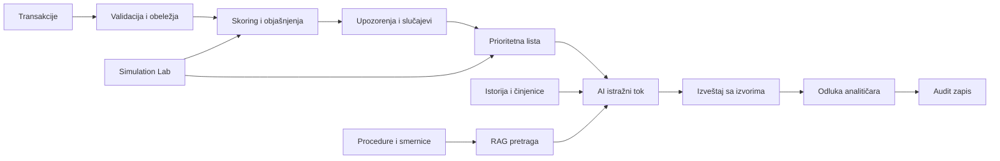

# FraudLens AI — originalna ideja i usvojeni plan

Status: usvojena početna osnova projekta.
Datum beleženja: 11. novembar 2026.
Tim: četiri člana. Rok: približno dve nedelje.

Ovaj dokument beleži predlog razvoja usvojen u razgovoru i dopune tima. Razrada implementacije, ugovori i zadaci nastaju u zasebnim specifikacijama. Dopune od 11. novembra nalaze se na kraju dokumenta. Ovo je polazna osnova, a ne evidencija implementiranih funkcionalnosti.

## 1. Polazna ideja i problem

**FraudLens AI — Inteligentna platforma za detekciju finansijskih prevara, AI istragu i optimizaciju prioriteta.**

Finansijske institucije obrađuju veliki broj transakcija, dok timovi za proveru imaju ograničen kapacitet. Upozorenja mogu sadržati mnogo lažno pozitivnih signala, bez jasnog objašnjenja rizika i korisnog redosleda istraga.

FraudLens AI analizira transakcije, dodeljuje ocenu rizika i otvara slučajeve. AI asistent prikuplja dostupne činjenice, pretražuje procedure kroz RAG i sastavlja izveštaj potkrepljen izvorima. Konačnu odluku donosi analitičar. Simulation Lab omogućava ponovljive eksperimente, a Decision Intelligence poredi strategije prioritizacije pod ograničenim resursima.

Za MVP je usvojen **AML scenario**, odnosno analiza sumnjivih tokova novca i prioritizacija AML provera. Predloženi operativni opis je:

> Platforma za prepoznavanje sumnjivih finansijskih tokova, pripremu AI istražnih izveštaja i prioritizaciju AML provera.

Naziv FraudLens AI ostaje. Oznaka pranja novca u datasetu nije jednaka oznaci prevare u plaćanju. U interfejsu koristiti izraze „sumnjiva aktivnost”, „rizik” i „potrebna provera”. Moguće odluke analitičara: eskalirati, zatvoriti uz obrazloženje ili zatražiti dodatne podatke.

Iznos AML transakcije nije dokaz gubitka banke. Za MVP prioritizacija koristi rizik, kapacitet i dokumentovane težine slučajeva. Očekivani finansijski gubitak može se uvesti samo uz odgovarajuće podatke ili eksplicitne simulacione pretpostavke.

## 2. Uklapanje u Bootcamp

Javno objavljen program podržava ovakav projekat, ali detaljna zvanična rubrika ocenjivanja nije dostavljena. Formalne uslove treba uskladiti sa mentorom.

| Modul | Primena | Dokaz |
|---|---|---|
| 1. AI-native engineering | SDD, TDD, verzionisanje i coding agent | Veza zahteva, testa i izmene |
| 2. Python i API | Backend za transakcije, skoring i slučajeve | API ugovori i integracioni testovi |
| 3. Promptovi, kontekst, strukturirani izlazi | Strukturirani istražni izveštaj | Šema i semantička evaluacija |
| 4. Tool calling | Čitanje činjenica, istorije i procedura | Stvaran trag poziva alata |
| 5. Stateful workflows | Istraga sa sačuvanim stanjem | Nastavak rada i kontrolisan oporavak |
| 6. RAG | Relevantne procedure i smernice | Proverljivi citati |
| 7. Kvalitet RAG-a | Kontrolisano poboljšanje retrieval-a | Poređenje na istim pitanjima |
| 8. Evaluacija | Provere pojedinačnih komponenti i celog sistema | Ponovljiv evaluacioni paket |
| 9. Bezbednost i etika | Ograničeni alati i ljudska odluka | Negativni i adversarijalni testovi |

Reproducibilnost pokriti zaključanim zavisnostima, verzijama podataka, konfiguracijama i uputstvom za demonstraciju.

Izvor: [SITA AI Bootcamp](https://sita.org.rs/ai-bootcamp/).

## 3. Datasetovi

### 3.1. Početni izbor za ML

**IBM Transactions for Anti-Money Laundering, HI-Small**, transakciona tabela `HI-Small_Trans.csv` iz odgovarajućeg izdanja.

- [Kaggle distribucija](https://www.kaggle.com/datasets/ealtman2019/ibm-transactions-for-anti-money-laundering-aml)
- [IBM dokumentacija](https://github.com/IBM/AML-Data)
- [Rad autora](https://arxiv.org/html/2306.16424v2)

Podaci su sintetički i sadrže oznake pranja novca. Rad autora opisuje HI-Small sa približno pet miliona transakcija. Stvarni preuzeti fajl, verziju, veličinu i raspodelu treba proveriti pre rada. Rezultati na sintetičkim podacima ne dokazuju performanse u stvarnoj banci.

Razvojni uzorak i kompletan evaluacioni tok držati odvojeno. Ne uzorkovati transakcije tako da se nenamerno izgubi istorija potrebna za obeležja i istragu. Uzorak, vremenske granice i eventualno uzorkovanje trening klase dokumentovati.

Na početku napraviti data card: izvor, verzija, licenca, značenje oznake, vremenski raspon, broj pozitivnih primera, nedostajuća polja i ograničenja vidljivosti. IBM razlikuje licencu repozitorijuma od licence podataka, koja je navedena kao CDLA-Sharing-1.0.

### 3.2. Razmotrene alternative

| Dataset | Procena za ovaj MVP |
|---|---|
| IEEE-CIS | Dobar za prevare u onlajn plaćanjima; maskirana obeležja i povezivanje tabela povećavaju obim |
| ULB Credit Card Fraud | Jednostavan klasifikacioni benchmark; PCA obeležja ograničavaju poslovno objašnjenje i AI istragu |
| Elliptic++ | Bogat kripto graf, ali uvodi poseban domen i dodatnu složenost |
| FCA APP | Bogat kontekst, ali više povezanih skupova i pristup platformi povećavaju rizik za rok |
| FiFAR | Relevantan za kapacitet i raspodelu rada; novija verzija pokriva upozorenja pri otvaranju računa i sintetičke analitičare |
| PaySim | Rezervna opcija za mobilne platne prevare; proveriti artefakte simulatora i dostupnost obeležja |

Ne spajati različite datasetove u zajednički trening samo zato što se svi odnose na finansijski kriminal. Njihove oznake, entiteti i procesi nastanka nisu zamenljivi.

Dodatna alternativa za platni scenario je [simulator iz Fraud Detection Handbook-a](https://fraud-detection-handbook.github.io/fraud-detection-handbook/Chapter_3_GettingStarted/SimulatedDataset.html). Za početni AML MVP nije potreban još jedan glavni dataset.

### 3.3. RAG korpus

Početni izbor je **sopstveni mali kurirani korpus**, radnog naziva `fraudlens-aml-knowledge-v1`. To je naziv našeg korpusa, a ne postojećeg javnog dataseta. Cilj je 10–20 pažljivo odabranih dokumenata ili samostalnih tematskih dokumenata, uz manji početni skup za prvu integraciju.

Korpus obuhvata:

1. Odabrane zvanične FinCEN izvore relevantne za AML obrasce i kvalitet istražnog narativa.
2. Odabrane FFIEC BSA/AML odeljke o upravljanju upozorenjima i dokumentovanju odluka, zajedno sa relevantnim ažuriranjima na koja se pozivaju.
3. Nekoliko internih procedura koje tim napiše za demonstraciju i jasno označi kao **simulirane**.
4. Dokumentaciju značenja polja i ograničenja IBM podataka.

Početni javni izvori za izbor odeljaka:

- [FFIEC: Suspicious Activity Reporting — Overview](https://bsaaml.ffiec.gov/manual/AssessingComplianceWithBSARegulatoryRequirements/04), prvenstveno delovi o upravljanju upozorenjima, odlučivanju i kvalitetu dokumentacije. Stranica upućuje na novije SAR FAQ dokumente; pre indeksiranja preuzeti i relevantna ažuriranja.
- [FinCEN FIN-2020-A003](https://www.fincen.gov/resources/advisories/fincen-advisory-fin-2020-a003), kao istorijski izvor za money mule tipologije, uz očuvan COVID-19 kontekst. Ne tretirati ga kao univerzalno ili važeće operativno pravilo za sve scenarije.

Predložene simulirane procedure: pregled upozorenja i eskalacija; struktura izveštaja i citiranje; obrada nedostajućih ili protivrečnih podataka. Ove procedure tek treba napisati i pregledati.

Za svaki dokument čuvati izvor, datum preuzimanja, datum objave/verziju, jurisdikciju, identifikatore odeljaka i sadržajni hash. Evidentirati koje odeljke uključujemo i zašto. Američke i britanske izvore ne predstavljati kao propise Srbije. Automatsko podnošenje regulatornih prijava nije deo MVP-a.

Financial Ombudsman je mogući budući izvor za platne prevare, uz kontekst pojedinačnog slučaja. SEC računovodstvene slučajeve izostaviti iz početnog AML korpusa.

### 3.4. SARSum kao evaluacioni skup

[SARSum](https://www.kaggle.com/datasets/leonardovalves/sarsum) prvenstveno koristiti kao dodatni benchmark za kvalitet sažimanja. [Opis autora](https://research.feedzai.com/publication/sarsum-a-relevance-and-comprehensiveness-aware-abstractive-summarization-dataset-for-suspicious-activity-reports/) navodi beleške, ključne činjenice i sažetke različitog kvaliteta.

Meriti zadržavanje važnih činjenica, nepodržane tvrdnje, nepotrebne informacije i slaganje automatske ocene sa ljudskim pregledom. SARSum nema automatsku vezu sa IBM transakcijama. Njegove beleške ne prikazivati kao istoriju konkretnog IBM slučaja. Referentne sažetke i evaluacione oznake držati van modelovog retrieval konteksta tokom testa.

## 4. Smislena uloga LLM-a

| Posao | Nosilac |
|---|---|
| Sabiranje iznosa, učestalost i vremenski prozori | Deterministički kod |
| Ocena rizika | Model ili dokumentovana početna pravila |
| Doprinos obeležja rezultatu modela | Metoda objašnjavanja modela |
| Pronalaženje relevantnih procedura | Retrieval |
| Povezivanje dokaza, alternativna tumačenja i istražni narativ | LLM |
| Rangiranje pod zadatim ograničenjima | Deterministički algoritam |
| Konačna odluka | Analitičar |

AI zadatak: iz transakcije, prethodne aktivnosti i pronađenih smernica sastaviti pregled razloga za sumnju, činjenica koje je ublažavaju, nedostajućih podataka i narednih provera. Činjenične i proceduralne tvrdnje povezati sa odgovarajućim izvorima.

Ako nema podataka o zanimanju, uređaju ili poreklu sredstava, model to navodi kao nedostatak. Visok skor nije izvor takvih činjenica. Izvor činjenice o slučaju razlikovati od izvora proceduralne preporuke: smernica o obrascu ne dokazuje da konkretan klijent učestvuje u njemu.

Predložena izlazna polja: `summary`, `observed_facts`, `risk_indicators`, `alternative_explanations`, `missing_information`, `recommended_checks`, `citations`.

## 5. Paralelan razvoj i operativni pipeline

Razvoj aplikacije i RAG-a ne čeka završetak ML-a. Pripremu organizovati kroz paralelne tokove:

| Tok | Rezultat |
|---|---|
| Podaci i skoring | Validirani podaci, model, objašnjenja i verzionisan rezultat |
| Znanje i RAG | Dokumenti, indeks i evaluaciona pitanja |
| Aplikacija i istraga | API ugovori, slučajevi, workflow i UI |

Evaluacija prati svaki tok od početka.



Objavljivanje izlaza skoringa znači verzionisani ugovor, na primer: `transaction_id`, `risk_score`, `model_version`, `feature_version`, `scored_at`, `explanation`. Konačna šema nastaje u specifikaciji.

Transakcije i istoriju dohvatati kroz kontrolisane upite nad bazom. RAG služi za procedure i dokumente, a ne za skladištenje svih ML predikcija.

**Mehanizam odvajanja zavisnosti:** aplikacija poziva stabilni interfejs skoringa. U početku on koristi jasno označen fixture ili jednostavna pravila; kasnije stvarni model vraća isti oblik rezultata. Jednako važi za provider adapter i retrieval interfejs. Izvor svakog rezultata mora biti vidljiv u tragu i demonstraciji.

## 6. Obim MVP-a

| Ekran | Obavezno ponašanje |
|---|---|
| Pregled upozorenja | Lista, rizik, filteri i prioriteti |
| Slučaj i AI istraga | Transakcija, istorija, objašnjenje skora, izveštaj i odluka |
| Izvori znanja | Dokumenti, verzije i citirani odeljci |
| Simulation & Evaluation | Poređenje konfiguracija i rezultata |

Za prvu verziju jedno upozorenje predstavlja jedan slučaj vezan za jednu transakciju. Povezane transakcije su dokazi. Složeno spajanje upozorenja odložiti jer menja workflow i evaluaciju.

Van početnog obima: GNN, treniranje transformera, autonomne intervencije nad računima, višeagentni sistem, otvorena internet pretraga tokom istrage i graf baza. Jednostavan prikaz veza je kasniji dodatak ako ostane vremena.

## 7. Skoring, AutoML i objašnjivost

Nema obaveze treniranja sopstvenog ML modela. Razvoj novog modela nije centralni cilj Bootcamp projekta. Ipak, skoring mora imati poznato poreklo, smisleno poređenje i evaluaciju.

Predloženi redosled:

1. Dokumentovana početna pravila kao poslovni baseline.
2. Jednostavan model, na primer logistička regresija.
3. Jedan model stabala.
4. Opcioni vremenski ograničen FLAML eksperiment.

Za aplikaciju izabrati **jedan model** koji se može objasniti i uporediti. Ograničiti listu AutoML modela i budžet pretrage. AutoML ne rešava izbor podataka, curenje informacija, vremensku validaciju ni smisao objašnjenja. Ansambl zadržati samo ako opravdava dodatnu složenost.

Objašnjivost pokazati kroz dostupnost i značenje obeležja, doprinos obeležja konkretnom skoru i proverljive činjenice iza njih. SHAP doprinos je objašnjenje rezultata modela, a ne dokaz uzroka pranja novca. Ako kalibracija menja izlaz modela, dokumentovati koji izlaz objašnjenje zaista opisuje.

### Pravila rada sa podacima

- Vremenski train/validation/test. Početni izbor nakon dopune tima je **70/15/15** po vremenskim granicama; proveriti da validacija i test imaju dovoljno pozitivnih primera. 80/10/10 ostaje alternativa ako broj primera to opravdava.
- Validacioni period unapred organizovati za izbor modela, kalibraciju i prag. Test ne koristiti za podešavanje.
- Istorijska obeležja računati samo iz podataka dostupnih do trenutka skoringa.
- Preprocesiranje učiti na trening podacima.
- U testu zadržati prirodnu zastupljenost klasa.
- `Is Laundering` držati van ulaza za predikciju i van LLM konteksta i istražnih alata. Oznaka je dostupna samo odgovarajućem trening/evaluacionom postupku.
- Deklarisati pogled jedne banke ili simulirani zajednički pogled više banaka.
- Identitet računa vezati za banku; iznose različitih valuta ne sabirati bez dokumentovane konverzije.
- Reprodukovati stvarnu dostupnost podataka; prototip istorijske AML analize ne predstavljati kao dokaz prevencije transakcija u realnom vremenu.

## 8. Decision Intelligence i Simulation Lab

Porediti tri strategije: FIFO, najveći rizik prvo i procenjeni značaj po jedinici vremena.

Početna heuristika:

`priority_i = p_i * weight_i / review_time_i`

`p_i` predstavlja kalibrisanu procenu rizika. Dok kalibracija nije potvrđena, koristiti naziv skor. `weight_i` je dokumentovana težina slučaja, a `review_time_i` procenjeno vreme provere. Nedostajuće poslovne podatke zameniti jasno označenim simulacionim pretpostavkama. Ova heuristika ne garantuje optimalnu raspodelu.

Simulation Lab je istorijski replay: na istom zamrznutom toku menjaju se prag, kapacitet i strategija. Prikazati pregledane slučajeve, pronađene pozitivne primere, propuštene pozitivne primere, lažne alarme i zaostatak. Konfiguraciju, verzije i seed sačuvati.

Primer pitanja: „Ako tim danas može da proveri 30 slučajeva, koja strategija pronalazi više relevantnih upozorenja i šta ostavlja nepregledano?”

Ako se dodaju veštački scenariji, oznake moraju poticati iz poznatih pravila generatora, uz jasno označavanje sintetičkog porekla.

## 9. AI workflow i bezbednosne granice

Početni alati: `get_case_facts`, `get_account_history`, `search_procedures`.

Server proverava argumente, pristup i granice. Model može birati potreban sledeći upit, ali ne bira identitet korisnika i nema proizvoljan SQL ili URL pristup.

Predložena stanja: `created → gathering_evidence → drafting → ready_for_review → reviewed`, uz `needs_information` i `failed`. Ograničiti korake, vreme i ponovne pokušaje. Timeout ostaje vidljiv kao neuspeh.

Validacija prihvaćenog izveštaja obuhvata šemu i reference. Postojanje citata ne dokazuje verno tumačenje izvora; semantički kvalitet se posebno evaluira. Konačnu odluku i audit zapis kontrolisati kroz backend i radnju analitičara.

## 10. SDD, TDD i specifikacije

Lokalni materijal: `week-03-week-04-svi-materijali-za-stampu.pdf`, naročito strane 44–53. Primeri mečeva i igara su samo primeri sa kursa. Na projekat se prenose inženjerski obrasci: mali zadaci, test pre implementacije, negativni primeri i usklađivanje specifikacije, koda i dokaza.

Prvobitno predložene funkcionalne celine:

| Celina | Korisnički rezultat |
|---|---|
| Transaction scoring | Uvoz, skoring, objašnjenja i kreiranje slučaja |
| Evidence investigation | Dokazi, RAG, AI izveštaj i ljudski pregled |
| Priority simulation | Rangiranje, kapacitet i eksperimenti |

Ova podela je početna; nije ograničenje na tačno tri Spec-kit feature-a. Dopunjena granularnost je u odeljku 15.

Spec-kit tok: constitution → specify → clarify → plan → checklist → tasks → analyze → implement → converge. Sintaksa zavisi od konkretne integracije i izdanja. Koristiti istu zaključanu verziju u timu.

Projektni principi: kritična logika se razvija uz testove; evaluacione oznake nisu dostupne istrazi; izvori su proverljivi; konačna odluka je ljudska; rad ima mali, pregledan obim.

| Acceptance scenario | Očekivani rezultat |
|---|---|
| Ponovljen uvoz transakcije | Nema duplog slučaja |
| Nedozvoljen slučaj | Podaci se ne vraćaju |
| Nema relevantne procedure | Izveštaj navodi ograničenje |
| Instrukcija u dokumentu | Ne menja dozvole i workflow |
| Nepoznat citat | Izveštaj se ne prihvata |
| Prekoračen kapacitet | Plan ne raspoređuje dodatne slučajeve |
| Provider ne odgovara | Kontrolisana greška i mogućnost nastavka |

Čuvati vezu zahtev → failing test → izmena → passing test → pregled. Za LLM kvalitet koristiti evaluacione skupove; test ne vezivati za doslovan tekst odgovora. Fake provider i fixture proveravaju aplikaciju, a ne sposobnost stvarnog modela.

## 11. Evaluacija

| Deo | Mere | Baseline |
|---|---|---|
| Skoring | Average Precision, Precision@K, Recall@K, lažni alarmi | Pravila i jednostavan model |
| Kalibracija | Pouzdanost procena, Brier score | Nekalibrisani model |
| Retrieval | Recall@5, relevantnost i verzija odeljka | Jednostavna pretraga |
| AI izveštaj | Pokrivenost činjenica, nepodržane tvrdnje, citati | Šablonski izveštaj |
| Workflow | Uspeh zadatka, greške i oporavak | Referentni scenariji |
| Prioritizacija | Pronađeni pozitivni primeri pri istom kapacitetu | FIFO i rizik |
| Upotrebljivost | Vreme pregleda i kvalitet odluke | Ručni pregled |

Početni obim: oko 40 anotiranih RAG pitanja i 30–40 slučajeva za AI istragu, sa razvojnim i odvojenim završnim delom. SARSum podskup je dodatni eksperiment. Parafraze i primeri istog šablona ostaju u istoj particiji. Mali skup je capstone provera, a ne dokaz široke produkcione generalizacije.

Kombinovati provere brojeva i referenci sa ljudskom ocenom tvrdnji. Deo izveštaja nezavisno pregledaju dva člana. Ne oslanjati se samo na ROUGE ili jednog LLM ocenjivača.

Za kontrolisano poboljšanje promeniti jednu stvar, na primer chunking ili retrieval konfiguraciju. Porediti na istim razvojnim pitanjima. Završni test pokrenuti kada su konfiguracije zaključane.

Razlikovati tvrdnju „sistem pravi bolji izveštaj” od tvrdnje „analitičar donosi bolju ili bržu odluku”. Druga traži korisnički eksperiment. Odluke članova tima nisu automatski nove ground truth oznake.

## 12. Ravnomerna podela rada

| Oblast | Odgovornost | Demonstrabilan doprinos |
|---|---|---|
| A: Podaci i skoring | Uvoz, obeležja, model/AutoML, objašnjenja | Transakcija do objašnjenog skora |
| B: Znanje i RAG | Korpus, indeks, citati, evaluacija | Izvor i dokaz poboljšanja |
| C: AI istraga | Provider, alati, workflow, izveštaj, pregled | Potpuna istraga i kontrolisan neuspeh |
| D: Prioriteti i simulacija | Queue, kapacitet, replay, poređenje | Rezultat pod ograničenim resursima |

Svako poseduje testove i evaluaciju svoje oblasti. UI podeliti po funkcionalnostima. Ne ostavljati sav frontend ili integraciju jednom članu. Review može rotirati A→B→C→D→A.

Svako na odbrani objašnjava svoj deo, jedan neuspešan slučaj, razlog promene i ograničenje. Codex piše kod uz ljudsko izvršavanje, pregled i razumevanje. Broj promptova nije mera završenog rada.

Zajednički ugovori uključuju `Transaction`, `RiskAssessment`, `Case`, `Evidence`, `InvestigationReport` i `SimulationRun`.

## 13. Okvirni plan za dve nedelje

| Radni dan | Posao | Proverljiv rezultat |
|---|---|---|
| 1 | Scenario, audit podataka, specifikacije i ugovori | Podaci dostupni i zajednički formati |
| 2 | Kostur aplikacije, početni skoring, RAG baseline, fixture tok | Jedan slučaj kroz aplikaciju |
| 3 | Obeležja, dokumenti, citati, pravi provider | Prva stvarna AI istraga |
| 4 | Integracija skoringa, alata i izveštaja | Izveštaj iz stvarnih dokaza |
| 5 | Odluka analitičara, stanje i audit | Potpun korisnički tok |
| 6 | Ograničeno poboljšanje modela i RAG-a | Poređenje pre/posle |
| 7 | Prioriteti i Simulation Lab | Poređenje pri istom kapacitetu |
| 8 | Evaluacija, negativni testovi i popravke | Ponovljiv evaluacioni paket |
| 9 | Zaključavanje verzija i priprema pokretanja | Drugi član pokreće po uputstvu |
| 10 | Probna odbrana i završne korekcije | Svako demonstrira doprinos |

Preostali kalendarski dani služe kao rezerva. Ovo nije potvrđen datum odbrane.

Do trećeg dana obezbediti stvarno dostupan LLM provider. Ako petog dana nema kompletnog toka, prvo ukloniti dodatne vizualizacije, drugi provider i napredni AutoML. Sačuvati izveštaj sa izvorima, ljudski pregled, evaluaciju i osnovnu simulaciju.

## 14. Tehnologije i odbrana

- Backend: **Python i FastAPI**.
- Frontend: **Vite i TypeScript**, jednostavan interfejs.
- Jedna aplikaciona baza; konkretan izbor zaključati u tehničkom planu.
- Lokalni retrieval indeks i verzionisani model.
- Jednostavan eksplicitni workflow i jedan dostupan LLM provider iza adaptera.
- Testovi za backend, ugovore i kritične korisničke tokove; zasebni AI evali.

TabFormer i Dgraph odložiti. Ne uvoditi infrastrukturu bez potrebe u MVP-u.

Na odbrani pokazati sumnjiv slučaj, lažni alarm i slučaj sa nedovoljnim dokazima. Zatim promeniti kapacitet i uporediti prioritete. Svaki član pokazuje svoj doprinos i ograničenja.

## 15. Dopune usvojene 11. novembra 2026.

### 15.1. Granice obima i način rada

Tim je potvrdio četiri ekrana, jedan objašnjiv produkcioni model za MVP i izostavljanje tema van obima Bootcampa ili raspoloživog vremena. Nove ideje se procenjuju po uticaju na postojeći tok i rok, a zatim se beleže u specifikaciji ili backlog-u.

Najvažnije je odvojiti ono na čemu svi mogu stalno da napreduju od dugotrajnih ML eksperimenata. Ugovori, fixture-i i zamenljivi adapteri omogućavaju razvoj UI-ja, workflow-a, RAG-a, evaluacije i prioriteta pre završetka modela. Zamena dataseta se izoluje u importeru i mapiranju u kanonsku šemu; zahteva novu proveru značenja oznake, obeležja, podela i metrika.

### 15.2. Predložena granularnost Spec-kit celina

Feature nije obavezno ekran niti tehnički sloj. Posebna specifikacija je korisna kada postoji samostalno ponašanje ili tehnički ugovor koji ima jasne kriterijume prihvatanja.

Predložena razrada:

| Celina | Vrsta | Obim |
|---|---|---|
| Foundation / bootstrap | Početna tehnička specifikacija | Pokretanje projekta, minimalni backend/frontend, test komande, osnovni ugovori i evidence pravila |
| Data ingestion and risk scoring | Funkcionalna/tehnička specifikacija | Importer, validacija, obeležja, skoring interfejs, početna pravila, model i objašnjenja |
| Knowledge ingestion and retrieval | Funkcionalna/tehnička specifikacija | Manifest izvora, obrada dokumenata, retrieval i citati |
| Case investigation and analyst review | Funkcionalna specifikacija | Slučaj, alati, AI workflow, izveštaj, odluka i audit |
| Priority queue and simulation | Funkcionalna specifikacija | Strategije, kapacitet, replay i poređenje |

Frontend i backend zadaci nalaze se uz odgovarajuću funkcionalnost. Posebna horizontalna specifikacija za ceo frontend ili ceo backend nije potrebna. Zajednički UI i servisni kostur pripadaju foundation-u. Evaluacija, bezbednost i reproducibilnost postoje u svakoj celini od početka.

Foundation mora biti kratak i upotrebljiv. Ne pisati kompletnu detaljnu specifikaciju svih budućih mogućnosti pre prvog radnog toka.

### 15.3. Verzije

Početni princip: izabrati najnovije stabilno izdanje dostupno pri inicijalizaciji, proveriti minimalno pokretanje i zaključati isto izdanje za sve članove. Tokom kratkog projekta ne nadograđivati automatski.

Pri proveri 11. novembra 2026. zvanični GitHub latest-release endpoint prijavio je **Spec Kit v1.4.0**, označen kao stabilno izdanje, objavljeno 10. novembra 2026. Dostupnost i kompatibilnost treba potvrditi pri stvarnoj instalaciji.

Izvor: [Spec Kit v1.4.0](https://github.com/github/spec-kit/releases/tag/v1.4.0).

### 15.4. Šta pripada sledećoj inicijalizaciji

1. Kratka foundation specifikacija i projektni principi.
2. Inicijalizacija Spec-kit-a i dogovor verzija.
3. Minimalna organizacija backend/frontend koda, testova, ugovora, podataka i evala.
4. Minimalni API i domen ugovori, sa primerima i kontrolisanim greškama.
5. Mali jasno označeni fixture-i, uključujući skoring adapter.
6. Prvi pokretljiv slučaj od API-ja do UI-ja.
7. Pravila za evidence zapise i čuvanje promptova.
8. Razrada sledećih specifikacija i paralelnih zadataka po zavisnostima.

Predložena buduća organizacija, koja tek treba da bude kreirana:

```text
original_idea.md
README.md
AGENTS.md
.specify/
specs/
contracts/
backend/
frontend/
tests/
data/
  raw/                 # lokalni veliki podaci, van Git-a
  processed/           # generisani podaci, van Git-a
  fixtures/            # mali pregledani test primeri
knowledge/
  manifest.json        # metapodaci, verzije, hash-evi i obuhvat
  demo-policies/       # jasno označene simulirane procedure
evals/
  datasets/            # razvojni primeri i odvojeni završni primeri
  results/
prompts/
  app/                 # verzionisani promptovi koje aplikacija izvršava
  development/         # relevantni originalni zadaci coding agentu
evidence/
  templates/
  tasks/               # stvarni RED/GREEN, evaluacioni i review zapisi
docs/
  decisions/
```

Spec-kit generiše svoje artefakte; ne praviti paralelne ručne kopije tih fajlova. Tačne putanje prilagoditi izabranoj verziji i usvojenim konvencijama. Tajne i veliki sirovi podaci ne ulaze u Git.

Evidence fajlove ne popunjavati izmišljenim rezultatima. U početku kreirati pravila i šablone, a stvarne rezultate dodavati nakon izvršavanja. Beležiti zahtev/task, verziju koda i podataka, komande, očekivani razlog RED pada, stvarni ishod, GREEN rezultat, regresiju, ograničenja i review.

Originalni razvojni prompt ostaje sačuvan; naknadne dorade dobijaју novi zapis ili Git istoriju. Promptovi aplikacije i instrukcije coding agentu imaju različitu svrhu i čuvaju se odvojeno. Iz zapisa ukloniti tajne i osetljive podatke.

Ovim dokumentom je sačuvana ideja i utvrđen naredni korak. Spec-kit, aplikacioni kostur, datasetovi i navedeni budući fajlovi još nisu inicijalizovani ili preuzeti.

## 16. Dodatne tehničke reference

- [Spec Kit](https://github.com/github/spec-kit)
- [FLAML](https://microsoft.github.io/FLAML/docs/Use-Cases/Task-Oriented-AutoML/)
- [SHAP TreeExplainer](https://shap.readthedocs.io/en/latest/generated/shap.TreeExplainer.html)
- [scikit-learn: kalibracija](https://scikit-learn.org/stable/modules/calibration.html)
- [Fraud Detection Handbook: Top-K metrike](https://fraud-detection-handbook.github.io/fraud-detection-handbook/Chapter_4_PerformanceMetrics/TopKBased.html)
- [Fraud Detection Handbook: vremenska validacija](https://fraud-detection-handbook.github.io/fraud-detection-handbook/Chapter_5_ModelValidationAndSelection/ValidationStrategies.html)
- [FastAPI](https://fastapi.tiangolo.com/)
- [Vite](https://vite.dev/guide/)
