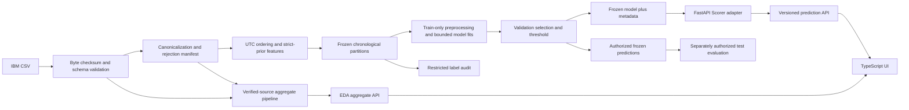

# Implementation Plan: Dataset, Machine Learning and EDA

**Branch**: `feature/002-clean-start` (observed; unchanged)
**Date**: 2026-11-18
**Spec**: [spec.md](spec.md)

## Summary

Deliver the smallest useful data-to-prediction workflow over IBM synthetic HI-Small: verify and prepare source locally, derive strict-prior features, freeze temporal partitions/protocol, compare a small model set, expose an opt-in local scorer behind the foundation boundary, and then add bounded aggregate EDA. The implementation must not depend on data or model artifacts for fixture startup. Showcase replay remains gated/deferred.

## Technical Context

**Language/Version**: Python 3.14.x; TypeScript; Node.js 24.x as established by Feature 001.
**Primary Dependencies**: Existing FastAPI/Pydantic/pytest/Ruff and Vite/TypeScript/Vitest. Proposed data/model libraries require a compatibility spike against Python 3.14 and the existing lockfile before dependency resolution.
**Storage**: Raw source outside Git; proposed processed columnar Parquet snapshots plus JSON manifests; transient external-sort/window state only if benchmark proves necessary. No database is mandated.
**Testing**: pytest contract/unit/integration, Vitest UI/API decoders, typecheck/build; synthetic fixtures; separate provenance and authorized evaluation evidence.
**Target Platform**: Local Windows PowerShell workflow.
**Project Type**: Existing single-repository FastAPI + vanilla TypeScript application.
**Performance Goals**: Process approximately five million records within approved local memory/disk ceilings; final ceilings are an unresolved decision to freeze after a representative synthetic benchmark.
**Constraints**: No full data/model requirement for fixture mode; no cloud, database server, ML microservice, browser full-data processing, or tracked large artifacts.

## Architecture and Data Flow



EDA branches from verified, authorized aggregate data. Scoring API has no target label. Evaluation labels and showcase records do not flow to the runtime scorer.

## Integration Points and Structure

Preserve current `backend/src/fraudlens/{scoring.py,contracts.py,main.py,settings.py,cases.py}` and frontend contract decoding. Proposed additions:

```text
backend/src/fraudlens/
  data/       # manifest, source mapping, bounded preparation, features, partitions
  training/   # frozen protocol, baselines, bounded search, evaluation gates
  scoring/    # artifact metadata/loader and Scorer adapter
  eda/        # aggregate computation and response models
backend/tests/{contracts,unit,integration}/
frontend/src/ # navigation/EDA view and typed API additions
frontend/tests/
data/{raw,processed,artifacts,eval}/  # ignored local outputs only
specs/002-data-and-risk-scoring/{contracts/,evidence plans in ../evidence/}
```

Exact module paths may follow existing import conventions, but no root contract copy or parallel API service is planned.

## Processing Approach

1. Download/acquire manually or through documented source method only after checking terms; implementation MUST NOT commit source data.
2. Hash raw bytes before parsing. Read identifiers and source fields as text. Validate header count and positional schema before accepting rows.
3. Emit canonical rows and a rejection ledger in deterministic chunks. Use a temporary, resumable staging directory; publish only a complete manifest-bound snapshot. Revalidate staged chunks on resume.
4. Normalize time under a frozen assumption and sort deterministically by instant plus stable row identity. The preferred proposal is a columnar snapshot followed by an external/bounded chronological pass. Benchmark a library-supported streaming/external-sort implementation; do not assume all five million rows fit in memory.
5. For each timestamp group, query/update 24-hour state in two phases: calculate every row from strictly earlier state, then apply the entire group. Expire values outside the declared `[t−24h,t)` interval. Keep sender paid currency and receiver received currency aggregates separate.
6. Establish source-count development/showcase boundary and scoreable dev split using timestamp/counts only. Freeze IDs and hashes before restricted aggregate label audit.
7. Freeze the protocol and resource configuration before any real-data model fit. Training and app runtime are separate commands and artifact lifecycles.

### Resource and recovery design

Hard memory and disk ceilings remain a blocking decision. Before real ingestion, benchmark synthetic datasets with representative cardinality/skew and freeze maximum RSS, free-space reserve, chunk size, maximum runtime, and checkpoint cadence. The runner must check available disk before staging and fail with a controlled message. Checkpoint IDs include source hash, code/schema version, config hash, row range, and output hash. Interrupted or partial outputs are never treated as published data. Exact approved ceilings are recorded in the frozen protocol.

## Model and Evaluation Architecture

- Feature contract is frozen independently of labels. Recommendation: current paid amount (`log1p` after validated nonnegative decimal conversion), payment currency, and payment format; categorical unknown behavior must be explicit.
- Baselines: training prevalence constant; depth-5/min-leaf-500 decision tree; L2 logistic regression.
- Candidate: maximum five declared `HistGradientBoosting` configurations, seed 42; validation AP, then P@20, then deterministic simplicity rule.
- Preprocessing, encoders and any scaling are fitted only on training. If labels are downsampled/weighted, only frozen training rows are affected.
- Threshold selected on validation by predeclared objective (recommended F0.5 pending decision). Test and showcase remain sealed.
- Store model, preprocessing, metadata, feature order/version, runtime/library versions, source/protocol hashes, training code revision, random seed, validation metrics, threshold method/value, and artifact checksum as one compatibility unit.
- Proposed serialization recommendation: prefer a format with safer inspection/loading such as `skops.io` if candidate estimator support and Python-version compatibility pass; otherwise use a native format only for trusted local artifacts with strict hash/version checks. Pickle/joblib must never load untrusted artifacts. Keep final choice open pending compatibility spike.
- Frozen predictions precede separately authorized test evaluation. Reports clearly label synthetic source and only claim the split actually measured.

## API and Frontend

Add narrow, read-only, versioned contracts; preserve current `/api/health` and `/api/cases` behavior. Recommended endpoints: `GET /api/transactions/{transaction_id}/risk`, `GET /api/model/results`, and bounded `GET /api/eda/summary` (with optional precomputed chart-series resources if needed). Transaction identifiers are opaque strings derived from stable canonical IDs, not foundation fixture `TX-###` syntax. Responses contain no target label. Validate closed schemas in Pydantic and TypeScript; return controlled eligibility/unavailable/not-found errors. Do not expose arbitrary query filtering over test/showcase label-bearing data.

Show prediction score, threshold status, feature/model version, synthetic-data notice, and defensible explanation. Show results only for their authorized partition. EDA chart summaries are computed on backend and bound by maximum points/categories; count denominators, UTC timezone and currency units are explicit. EDA route/page implementation is conditional on an approval record.

## Testing and Verification Strategy

- RED → GREEN → REFACTOR for new business behavior; demonstrate RED is the intended missing behavior.
- Synthetic unit tests for parsing, duplicate headers, identity, decimal/currency checks, UTC equivalence, ties, exact 24h interval, warm-up, restart/hash, partitions and score validity.
- Contract/security-negative tests for labels, arbitrary test/showcase queries, invalid payloads, artifact mismatch, unsupported runtime and fixture fallback.
- Real-source provenance checks are separate from synthetic tests; no source/model quality claim without actual relevant run.
- Authorized model-development experiments and separately authorized holdout evaluation are distinct evidence records.
- Frontend contract/integration checks verify safe text rendering, no labels, units, empty/error/retry and bounded data.
- Human review/reproduction is recorded separately; one setup is not second-person reproduction.

## Constitution Check

**Pre-design**: PASS with gates. Work is within the approved AML educational concept and existing architecture. Human authority, label isolation, replaceable scorer, deterministic arithmetic, traceable contracts, local artifacts, and honest synthetic-data claims are preserved. No GNN, transformer, graph database, RAG, external provider, intervention, or service infrastructure is introduced.

**Post-design**: PASS subject to explicit blockers: (1) team approval for dedicated EDA page and its schedule impact; (2) approval before applying proposed +10% relative validation AP feature admission; (3) protocol decisions and resource ceilings before data/model execution; (4) separate explicit authorization before test labels are accessed. These gates do not authorize implementation by themselves.

## Open Decisions

| Decision | Options | Recommendation | Implementation impact | Required before |
|---|---|---|---|---|
| Timezone-naive timestamp | Source-declared zone; explicit project UTC assumption; reject pending clarification | Treat as UTC only if documentation leaves it unspecified, record assumption; otherwise stop | Changes canonical instants, warm-up, feature windows and every temporal boundary | Ingestion |
| Current-transaction features | Amount only; amount + currency + format; omit current fields | Amount `log1p` + payment currency + format; freeze before experiments | Changes feature schema, preprocessing and model artifact compatibility | Feature generation |
| Resource ceilings | Measured developer-machine limits; fixed team baseline | Benchmark and record RSS, disk reserve, runtime, chunk and checkpoint limits | Determines storage engine, chunk sizes, sort strategy and whether full source run is feasible | Full ingestion |
| Model candidate grid | Up to five predeclared configurations | Small shallow/regularized grid; freeze exact values before fitting | Bounds compute and affects deterministic selection/model complexity | Model training |
| Threshold objective | F0.5; minimum precision with recall tie-break; another declared objective | F0.5, deterministic threshold tie rule; team decision | Changes review status and alert volume in API/UI and evaluation | Validation |
| Artifact format | ONNX; skops; trusted joblib/native model | Compatibility/security spike; prefer safer inspectable format supported by chosen model | Determines dependency, loader, version checks and runtime portability | Runtime integration |
| EDA page | Approve dedicated route; defer to existing screen | Approve only with written benefit and schedule impact; no approval asserted here | Adds a separately navigable UI destination, tests, chart/accessibility work and delivery time | EDA UI |
| Feature admission margin | No added features; proposed +10% relative AP over frozen baseline | Apply only after team approval; preserve interpretability | Controls whether feature experiments can expand input schema and evaluation schedule | Any feature experiment |
| Class strategy | None; weighting; deterministic negative downsample | Start with none, compare only predeclared allowed options | Changes training population/objective; must not alter validation/test/showcase prevalence | Training |

## Complexity Tracking

No infrastructure expansion requested. A columnar format and bounded temporal state are justified by source volume; select the simplest option that meets measured resource constraints. Do not introduce SQLite, database services, or a charting package by default.
