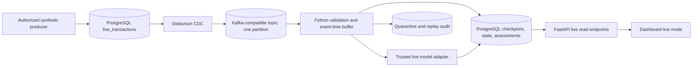
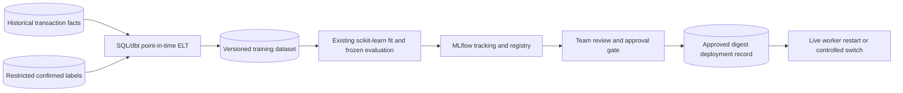
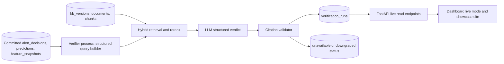

# Technical plan: Feature 005

**Status:** proposed, unimplemented. [Specification](spec.md) · [research](research.md) · [contracts](contracts/README.md) · [tasks](tasks.md). The technology stack extends the current MVP and requires the T001 team scope decision before implementation. All paths below are **proposed** unless explicitly identified as existing.

## Architecture

The live path has **one ordered topic partition and one active worker** in v1. Partitioning by transaction ID, sender or receiver independently would split a transfer's two account histories and break deterministic feature parity. The database transaction, not Kafka's committed offset alone, is the authoritative checkpoint. Multiple workers require a separately reviewed ownership/coordination design and parity proof.

## Boundaries and modules

| Existing verified boundary | Proposed additive module/path | Responsibility |
|---|---|---|
| `backend/src/fraudlens/feature_history.py` | `backend/src/fraudlens/live_features.py` | Reuse catalog/semantics; durable event-time replay and offline/live parity. |
| `backend/src/fraudlens/data_contracts.py` and `model_scoring.py` | `backend/src/fraudlens/live_contracts.py`, `live_model.py` | Validate new live request/assessment; retain trusted artifact loader and unchanged batch v2 checks. |
| `backend/src/fraudlens/data_store.py` | `backend/src/fraudlens/live_store.py`, `backend/migrations/` | PostgreSQL immutable facts, buffer, state, checkpoints, predictions, alerts and labels with separate roles. |
| `backend/src/fraudlens/pipeline_cli.py` | `backend/src/fraudlens/live_worker.py`, `live_reconcile.py` | Connector event handling, ordered finalization, retries and explicit repair. Existing offline CLI stays. |
| `backend/src/fraudlens/main.py` and `settings.py` | additive live router/settings | Read-only live API; fixture and batch modes unchanged. |
| `web/src/` | additive live API types/view and mode selection | Display versioned live evidence; no browser model execution. |
| `uv.lock`, `web/package-lock.json` | reviewed lockfile updates | Pin only dependencies actually introduced by implementation tasks. |
| No infrastructure or MLOps directories | `infra/compose/`, `dbt/`, `backend/src/fraudlens/mlops/`, `observability/` | Local services, offline ELT, tracking and metrics; all proposed. |

The [current v2 request](../../backend/src/fraudlens/data_contracts.py) requires a canonical CSV-derived transaction, matching `dv_...` dataset version, `history-v1` snapshot/digest and run identity. [ModelScorer.input_row](../../backend/src/fraudlens/model_scoring.py) enforces the trained dataset version. A live PostgreSQL row has no CSV ordinal or that dataset lineage. The proposed `LiveModelAdapter` must **not** forge a `dv_` identity or disable these validators. It loads a reviewed local artifact using the existing `load_trusted_artifact` and the artifact's approved *training* dataset/protocol identity; then it validates a separate `LiveScoreRequestV1`, ordered feature names/values, preprocessing signature and serving-compatibility digest before calling the pipeline. It returns a `LivePredictionV1` with distinct live source lineage, deployment digest, feature digest, score and explanation. The old scorer and batch tests remain as regression gates.

## Ingestion, order and correctness

1. **SQL ingest:** a producer inserts immutable canonical facts and an ingestion ID into PostgreSQL in one transaction. `transaction_id` is supplied by the authorized producer and unique across the live source; it is not based on CSV ordinal. A database trigger/policy rejects updates or deletes to immutable facts. Use exact decimal text or `NUMERIC` with reviewed bounds, not floating storage. Both sender and receiver include bank plus account. Record UTC event time and independent server ingestion time. A producer retry with the same ID/fact digest is idempotent; changed facts are a conflict.
2. **CDC:** Debezium captures committed inserts from an allowlisted table/publication through one monitored logical replication slot. Configure initial snapshot behavior deliberately: for an empty live table start with no-data snapshot; for migration, take an explicit consistent backfill and record the LSN handoff. Changes to rows, tombstones and schema-incompatible envelopes go to quarantine, not feature state. Monitor slot/WAL retention.
3. **Broker:** proposed `fraudlens.live-transactions.v1` topic, one partition, key `transaction_id`, durable retention longer than maximum outage plus replay window. `fraudlens.live-quarantine.v1` records failures without sensitive payloads. The worker polls at least once, validates the Debezium source/operation/schema and canonical event, then stores the event in a durable PostgreSQL pending buffer. It commits the Kafka offset only **after** the PostgreSQL transaction containing buffer/dedup/checkpoint commits. The DB checkpoint is monotonic and authoritative; redelivery checks identity and digest. Retry transient failures with bounded backoff; invalid/permanent failures are quarantined with reason and operator-controlled replay. Do not move the checkpoint past an event unless its buffer or quarantine decision is durable.
4. **Event-time finalization:** use a proposed 120-second allowed-lateness interval, subject to tests and team approval. In the same DB, persist `max_seen_event_time` and `watermark = max_seen - 120 seconds`. Reject implausibly far-future event times before they advance the watermark. Finalize only groups with `event_time < watermark`, sorted by `(event_time, transaction_id)`. For each group, query prior events in `[t-24h,t)`; take all group snapshots **before** adding any group event to durable history. A quiet stream needs an explicit, auditable watermark-advance control or scheduled heartbeat with guarded event-time bounds; no hidden wall-clock finalization. Events that arrive at/before a finalized watermark are quarantined for reconciliation; v1 does not silently revise published scores. Fresh-start coverage is incomplete until 24 hours of continuous observed history or an approved, contiguous backfill has been verified. No backfill means no live model score during warm-up.
5. **Inference and persistence:** resolve an approved deployment digest at batch boundary; each assessment stores that exact digest, training lineage and serving contract ID. Compute raw feature payload/digest, score, explanation and an independent alert decision from a versioned policy. In one PostgreSQL transaction, insert immutable snapshots/predictions/decisions, update sender/receiver state and watermark/checkpoint, and record dedup. Unique keys prevent a replay from creating duplicates. DB commit precedes Kafka offset commit. A crash before DB commit replays; a crash after DB commit replays as a no-op. If a model or contract fails, do not advance the finalized checkpoint; quarantine with reason only under a reviewed policy. Test all crash points.

**Late/replay policy:** within the not-yet-finalized buffer, reorder by event time. Beyond watermark, quarantine and require operator-led reconciliation: identify affected 24-hour neighborhoods, pause publication, recompute into a new generation, compare predictions/alerts, then explicitly switch active generation. Never mutate previously published facts/assessments in place. Backfill with a continuous history segment, fixed model/policy and recorded source range. An outage that exceeds broker/WAL retention becomes an explicit gap and cannot be described as complete coverage.

## API, ML lifecycle and operations

The proposed `/api/live/v1/alerts` and `/api/live/v1/alerts/{case_id}` read only committed active-generation assessments. Cursor pagination uses `(event_time DESC, transaction_id ASC)` plus generation and policy version; a stale generation returns a controlled conflict. Health reports source/worker freshness and unavailability without secrets. The UI adds a separate live mode and labels score kind, event/ingest/score times, feature coverage, artifact digest and alert policy. No HTTP request performs inference. API responses and pagination are in [live-alert-api.md](contracts/live-alert-api.md).

Offline SQL/dbt materializes immutable, versioned training snapshots with exact as-of joins and an explicit label cutoff. Only confirmed labels available by that cutoff enter evaluation; no label or label-derived field becomes a predictor. Dataset/source hash, feature policy, split membership, code/dependency versions, model digest and metrics are logged to MLflow. Registry aliases/tags aid discovery, but a separate approved deployment table pins an exact digest; moving a mutable alias alone cannot deploy. Promotion needs predeclared quality/capacity/parity gates, human review and a reversible atomic pointer update. Rollback restores the prior digest and records who/when/why. Existing Feature 002 T065/T066 blocks and prior holdout exposure prevent treating the boosted candidate's 19/20 as prospective acceptance.

Prometheus metrics: CDC slot/WAL lag, broker offset lag, pending buffer age, watermark lag, quarantine count, scoring latency, DB commit/retry failures, active model/policy digest and delayed-label evaluation coverage. Grafana panels and alerts must avoid raw transaction/account labels. Secrets come from local ignored env/secret mounts; Compose binds local services to loopback by default. Separate DB roles govern producer, connector, worker, label curator, registry operator and read-only API. A restore/replay drill, redacted logs and least-privilege checks are required before final acceptance.

**Proposed performance gate:** p95 SQL commit-to-persisted-assessment ≤180 seconds at 1 event/second *after* full warm-up, with an input stream whose event-time watermark can advance. This budget includes the proposed 120-second lateness hold; measure on declared host and pinned images, and report cold-start, low-traffic watermark stalls and unavailable-model periods separately. This is not an observed SLA.

## Migration and verification sequence

Keep Feature 002 SQLite/CLI and fixture APIs untouched. Add PostgreSQL schema and synthetic producer first, then CDC and durable buffering, then parity-tested history/inference, then live API/UI, then offline ELT/registry and observability. Run the live path in shadow mode with a separately pinned candidate; compare feature/prediction outputs before any analyst activation. Activation is a reviewed database pointer switch. Roll back that pointer, then stop worker/connector if integrity is uncertain; preserve audit and replay ranges. [Tasks](tasks.md) follow this order. No infrastructure, migrations, tests or benchmark were run while writing this plan.

## Proposed Phase 7 architecture: verification layer and showcase site

All paths and behavior below are proposed; no service or application behavior was run or verified for this revision.

## 1. Diagram (new, third flowchart)

## 2. Rows for the boundaries table

| Existing verified boundary | Proposed additive module/path | Responsibility |
|---|---|---|
| `backend/src/fraudlens/live_store.py` (proposed in T004) and `backend/migrations/` | `backend/migrations/007_knowledge_base.sql`, `008_verification.sql` | Knowledge-base versions and verification config/runs tables, separate from predictions and alert decisions. |
| `backend/src/fraudlens/live_api.py` (proposed in T027) | additive fields in the same module; `contracts/live-alert-api.md` update | `verification` and `review_priority_suggestion` on alert detail; verdict and status on the list. No request-time LLM call. |
| `web/src/pages/Cases.tsx` (T029) | `web/src/pages/`, `backend/src/fraudlens/rag/` | Dashboard evidence panel; knowledge-base build, query builder, verifier, citation validator; showcase pages in the same React app. |

## 3. Verification layer (proposed)

**Position in the pipeline.** The verifier is a separate process with its own database role. It polls committed `alert_decisions` for the active generation, selects rows where `alert` is true, coverage is full, and no `verification_runs` row exists for the active verification config, and processes them in `(event_time, transaction_id)` order. Because it only reads committed rows, the worker's atomic output transaction (FR-009) never waits on it, and a verifier crash cannot move the checkpoint. This keeps the existing rule that the database transaction, not an offset, is authoritative.

**Query construction.** The query text is built from the persisted `feature_snapshots` feature JSON, `predictions` score and explanation, and coverage state, mapped to descriptor bands defined in the feature contract. It never reads `confirmed_labels`, never reads source free-text, and never includes account identifiers. The 11 `history-v1` features are the only numeric inputs.

**Retrieval and verdict.** Hybrid keyword and dense search over the pinned `kb_version`, rerank, then a structured-output LLM call with the rule "use only the provided passages; answer `uncertain` if insufficient; cite passage ids". The citation validator checks every cited id against the retrieved set, enforces schema validity, and downgrades to `uncertain` on any failure. One retry on parse failure, then `status = unavailable`.

**Generations.** A verification belongs to `(generation, transaction_id, config_id)`. A replay generation (FR-012) produces new assessments, so it gets new verifications on demand; verifications are never copied across generations. Rolling back a generation or model digest does not delete verification rows; the API simply reads those matching the active generation and config.

**Configuration governance.** The corpus, embedding model, LLM and prompt version are pinned in a `verification_configs` row approved by a named reviewer, mirroring the `deployment_versions` pattern. A mutable alias or a silent prompt edit cannot change what runs. Changing any of the four creates a new config and requires the same review.

**Authority.** A verification is advisory. It cannot change a score, an alert decision, a case, or generation state, and no API or UI path acts on it automatically. Its absence, `skipped` and `unavailable` states are first-class and displayed.

**Operations.** Separate `verifier` role: read on committed assessment tables, write on verification tables only; API role gets read on verification tables; neither the worker nor the label curator role gets access. The LLM credential lives only in the verifier's ignored env or secret mount. Compose services stay loopback-bound. If decision (h) does not permit external calls, a local model or a mock provider labelled as such is the only option, and the site must say so.

**Site.** The showcase site is a read-only client. It consumes generated static JSON and, once T055 exists, the FR-010 endpoints; it adds no write endpoint and no transaction input. Until the live path exists it reads fixture and Feature 002 batch results with a visible source badge.

## 4. Additions to existing paragraphs

- **Prometheus metrics sentence:** append "verification latency, cost, empty-retrieval rate, parse-failure rate, unavailable rate and citation-downgrade count, with no raw transaction, account or passage-text labels."
- **Performance gate paragraph:** append "The NFR-001 budget excludes verification. Verification latency is measured and reported separately in T059; no target is asserted until measured."
- **Migration and verification sequence:** append "The verification layer is added after the live API (Phase 4) and runs first in shadow: verdicts are stored and compared on the evaluation set before the dashboard shows them to analysts. Site foundation work (T057) needs only T047 and may proceed in parallel with Phases 2 to 6; site pages (T058) start from fixture and batch data."
